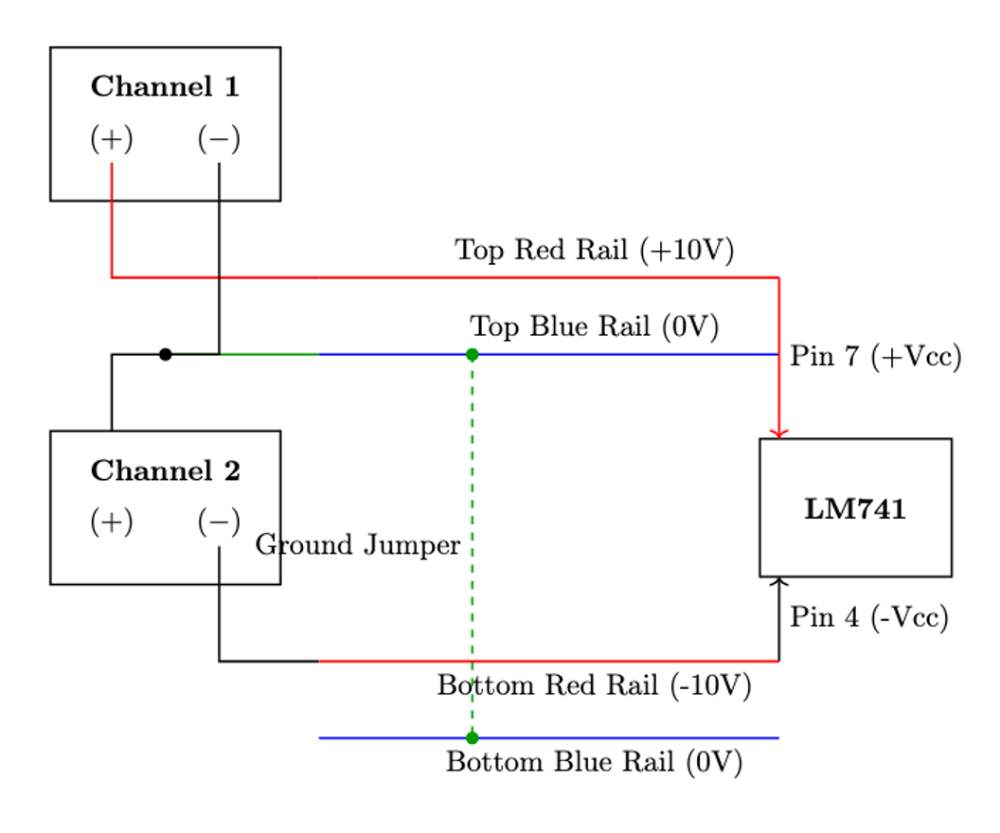
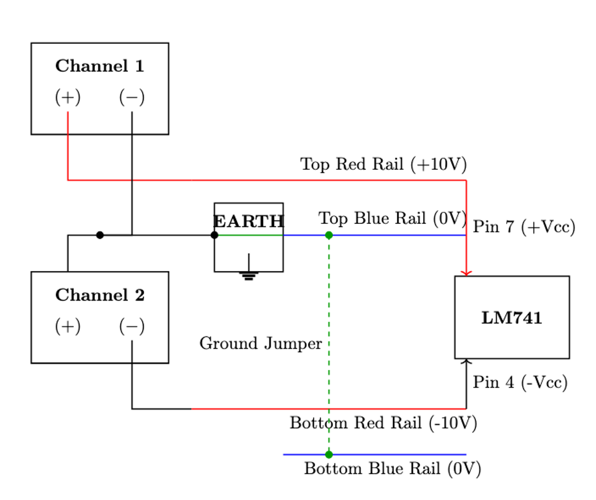
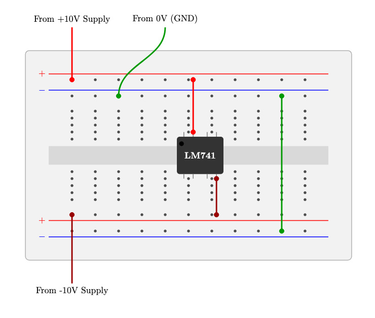

Setting up a dual (bipolar) supply on a standard prototyping breadboard requires bridging two independent power supply channels to create a **0V Common Reference (Ground)**. This module demonstrates three standard configurations for safely wiring your benchtop equipment.

## Introduction: Why Use Dual Supplies?

While operational amplifiers (like the classic LM741) are the most common classroom examples, a split supply (+V, -V, and Ground) is a standard requirement across many analog systems. This topology allows AC signals to swing both above and below 0V without clipping. 

Common applications include:

* **Audio Power Amplifiers:** Driving speaker cones push-pull (forward and backward from a resting center point) without needing signal-degrading DC blocking capacitors.
* **Data Converters (ADCs/DACs):** Instrumentation converters often process true bipolar AC signals centered precisely at 0V.
* **Waveform Generators:** Wien-bridge oscillators require bipolar supplies to output pure sine waves centered on a 0V axis.

::: {.callout-warning}
## Hardware Orientation Note
To match standard laboratory breadboards, the diagrams below feature **flipped bottom power rails**. The top rail is oriented as `Red (+), Blue (-)` while the bottom rail is oriented as `Red (+), Blue (-)`. Always double-check your physical board's painted lines before applying power!
:::

---

## 1. Configuration 1: Floating Ground (Series Mode)

This configuration establishes a standard floating 0V common reference. It is ideal for general physical hardware measurements using a digital multimeter (DMM).

### Schematic & Wiring

{fig-align="center" width="80%"}

### Theory of Operation

**Creating the Series Bridge:**
By connecting the negative terminal of Channel 1 to the positive terminal of Channel 2, we create a series bridge. This physical junction becomes our new **0V reference node**. 

**Relative Voltages:**
* The positive terminal of Channel 1 now provides a relative positive voltage (e.g., +10V with respect to the bridge).
* The negative terminal of Channel 2 provides a relative negative voltage (e.g., -10V with respect to the bridge).

**What does "Floating" mean?**
Because this ground is "floating," it is entirely isolated from the building's earth ground. This is perfectly safe for standard multimeters, which also float.

---

## 2. Configuration 2: Earth-Referenced Ground

This configuration ties the series bridge directly to the bench power supply's physical Earth ground terminal.

### Schematic & Wiring

{fig-align="center" width="80%"}

### Oscilloscope Safety & Grounding

**The Ground Clip Hazard:**
When measuring signals with a standard bench oscilloscope, the black alligator ground clip on the probe is internally tied to the building's Earth Ground via the oscilloscope's AC power plug. If you connect an oscilloscope ground clip to a node other than 0V in a floating circuit, you create a direct short circuit to ground.

**The Solution:**
By tying the series bridge directly to the power supply's physical Earth terminal (often a green terminal on the front panel), you lock the circuit's 0V reference to the room's electrical ground. This ensures that the circuit's ground and the oscilloscope's ground are at the exact same electrical potential, making dynamic AC measurements completely safe.

---

## 3. Configuration 3: Physical Breadboard Wiring Layout

This diagram simulates a physical breadboard to help new users transition seamlessly from theoretical schematics to bench hardware. 

### Visual Layout

{fig-align="center" width="80%"}

### Implementation Notes for Students

When transitioning from the schematic to hardware, follow these best practices:

1. **IC Placement:** The LM741 Op-Amp spans the central isolation trench. This is critical to prevent its internal pins from shorting together across the horizontal rows.
2. **Power Routing:** The +10V supply routes exclusively to the top red rail, while the -10V routes to the bottom red rail. Keep wiring neat to avoid accidental shorts.
3. **The Common Ground Jumper:** A green jumper must explicitly bridge the top blue rail to the bottom blue rail. If you forget this jumper, the bottom half of your circuit will lack a 0V reference and fail to operate correctly.

---

## LaTeX / TikZ Source Code (For Instructors)

```latex
% Compile this block in Overleaf or TeXShop to generate the breadboard layout
\begin{center}
\begin{tikzpicture}[scale=0.85, transform shape]
    % Breadboard Body
    \fill[black!5!white, rounded corners] (0, -4.5) rectangle (14, 4.5);
    \draw[thick, black!30!white, rounded corners] (0, -4.5) rectangle (14, 4.5);
    
    % Central Trench
    \fill[black!15!white] (1, -0.4) rectangle (13, 0.4);

    % Power Rails (Top)
    \draw[red, thick] (1, 3.5) -- (13, 3.5);
    \draw[blue, thick] (1, 2.8) -- (13, 2.8);
    \node[red, left] at (1, 3.5) {$+$};
    \node[blue, left] at (1, 2.8) {$-$};
    
    % Power Rails (Bottom) - Flipped Orientation
    \draw[red, thick] (1, -2.8) -- (13, -2.8);
    \draw[blue, thick] (1, -3.5) -- (13, -3.5);
    \node[red, left] at (1, -2.8) {$+$};
    \node[blue, left] at (1, -3.5) {$-$};
    
    % Breadboard Holes
    \foreach \x in {2,3,...,12} {
        \fill[black!70!white] (\x, 3.25) circle (0.06);
        \fill[black!70!white] (\x, 2.55) circle (0.06);
        \fill[black!70!white] (\x, -2.55) circle (0.06);
        \fill[black!70!white] (\x, -3.25) circle (0.06);
        \foreach \y in {0.7, 1.0, 1.3, 1.6, 1.9} {
            \fill[black!70!white] (\x, \y) circle (0.06);
            \fill[black!70!white] (\x, -\y) circle (0.06);
        }
    }

    % LM741 IC
    \fill[black!80!white, rounded corners=1mm] (6.5, -0.8) rectangle (8.5, 0.8);
    \node[white] at (7.5, 0) {\textbf{LM741}};
    \fill[black] (6.7, 0.5) circle (0.1); 
    
    \foreach \x/\pin in {6.8/1, 7.2/2, 7.8/3, 8.2/4} { \draw[thick, gray] (\x, -0.8) -- (\x, -1); }
    \foreach \x/\pin in {8.2/5, 7.8/6, 7.2/7, 6.8/8} { \draw[thick, gray] (\x, 0.8) -- (\x, 1); }

    % Wiring Connections
    \draw[red, line width=1.5pt] (2, 5.5) node[above, text=black] {From +10V Supply} to[out=-90, in=90] (2, 3.25);
    \filldraw[red] (2, 3.25) circle (0.1); 
    
    \draw[red!60!black, line width=1.5pt] (2, -5.5) node[below, text=black] {From -10V Supply} to[out=90, in=-90] (2, -2.55);
    \filldraw[red!60!black] (2, -2.55) circle (0.1); 

    \draw[green!60!black, line width=1.5pt] (6, 5.5) node[above, text=black] {From 0V (GND)} to[out=-90, in=90] (4, 2.55);
    \filldraw[green!60!black] (4, 2.55) circle (0.1); 

    \draw[green!60!black, line width=1.5pt] (11, 2.55) to[out=-90, in=90] (11, -3.25);
    \filldraw[green!60!black] (11, 2.55) circle (0.1);
    \filldraw[green!60!black] (11, -3.25) circle (0.1);
    
    \draw[red, line width=1.5pt] (7.2, 1.0) to[out=90, in=-90] (7.2, 3.25);
    \filldraw[red] (7.2, 1.0) circle (0.1); \filldraw[red] (7.2, 3.25) circle (0.1);
    
    \draw[red!60!black, line width=1.5pt] (8.2, -1.0) to[out=-90, in=90] (8.2, -2.55);
    \filldraw[red!60!black] (8.2, -1.0) circle (0.1); \filldraw[red!60!black] (8.2, -2.55) circle (0.1);
\end{tikzpicture}
\end{center}
```